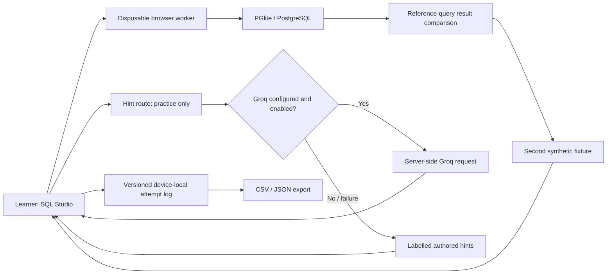

# Architecture and Trust Boundaries

## Current prototype

## Implemented boundaries

- The database worker contains only synthetic sample data and is terminated after each run or after 30 seconds.
- PostgreSQL read-only transactions reject ordinary writes, including write CTEs. Input screening is a convenience filter, not a SQL parser or security sandbox.
- The worker has no model key or production database credentials.
- The Groq key is read only on the server. Model responses are plain text, not executable HTML.
- Assessment exercise IDs are rejected by the hint route. The UI also removes coach and solution controls.
- Exported CSV cells are quoted and guarded against leading spreadsheet formula characters.
- Persisted records are parsed against a version-specific schema before display.

## Known limits

- Reference solutions are shipped to the browser. A technically motivated learner can inspect them. This is not a proctored assessment.
- There is no server-authoritative session, cohort randomization, or cross-device identity yet.
- CPU and memory abuse are bounded imperfectly: worker termination is a recovery mechanism, not a production resource quota.
- Groq rate limiting is in-memory and best effort; leave live tutoring disabled on a public deployment until authentication and durable limits are added.
- Multiple sessions on one device are not multiple learners. A new session cannot be treated as an independent participant.

## Required production / brief integration

1. Obtain the supplied SQL schema and exercise requirements.
2. Provision Supabase Auth, participant/session records, consent records, and RLS policies.
3. Keep arbitrary learner SQL out of the application database. Use a separately isolated execution boundary, populated from an approved course fixture.
4. Make assessment assignment and grades server-authoritative.
5. Add stable model, prompt, curriculum, and dataset version identifiers to the event log.
6. Add an ordinary answer-giving assistant condition with the same model and content budget.

This integration is a planned extension, not a representation of the current implementation.
